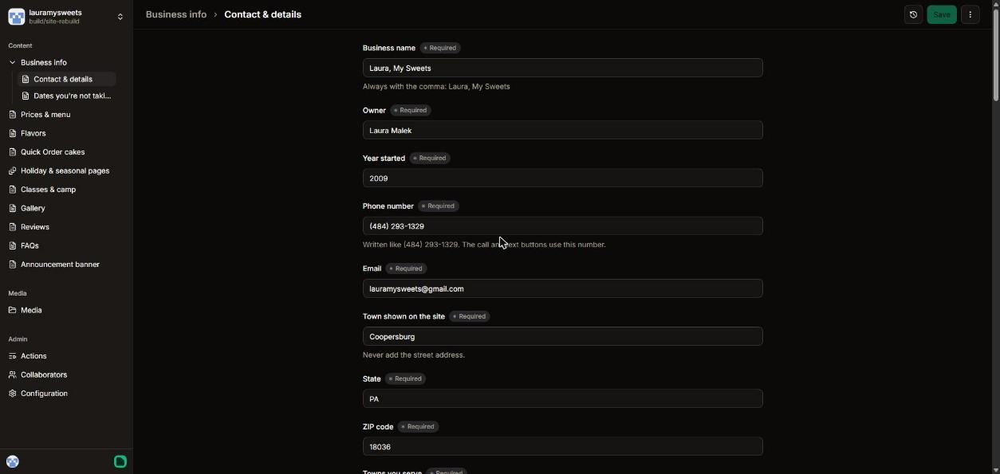
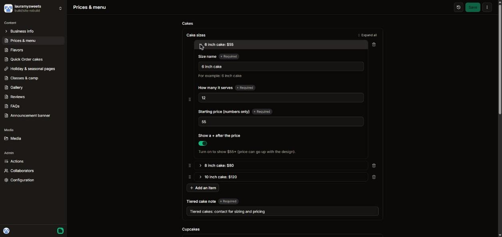
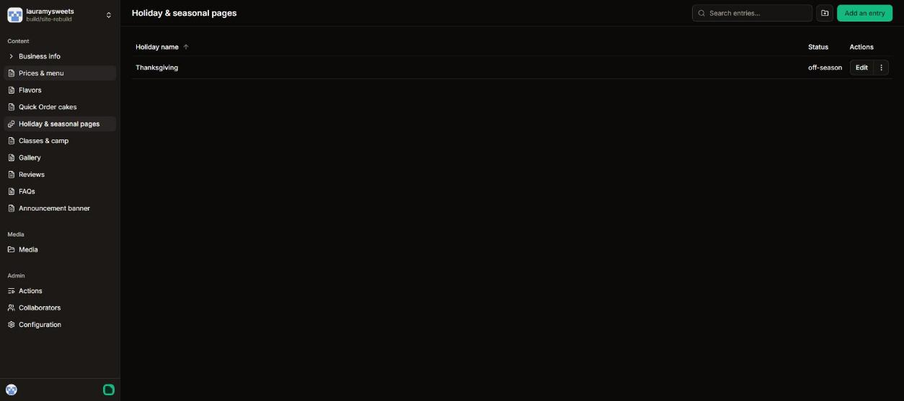
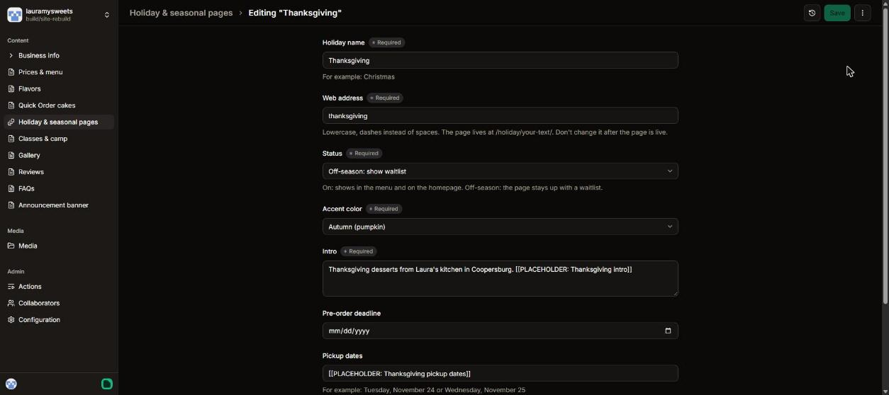
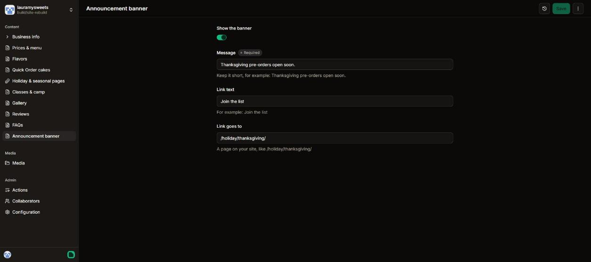
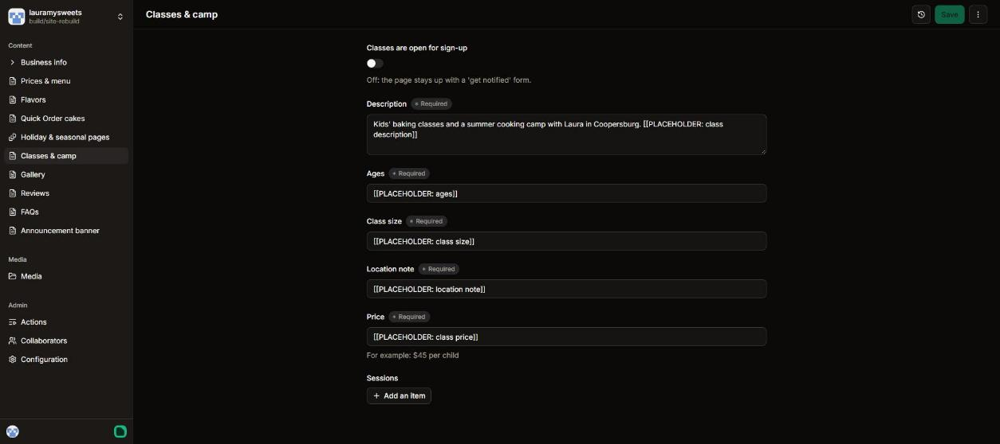
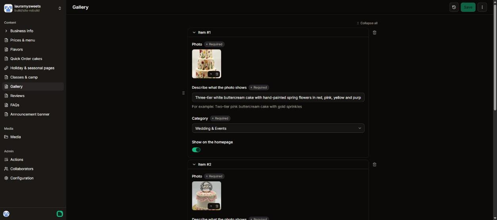
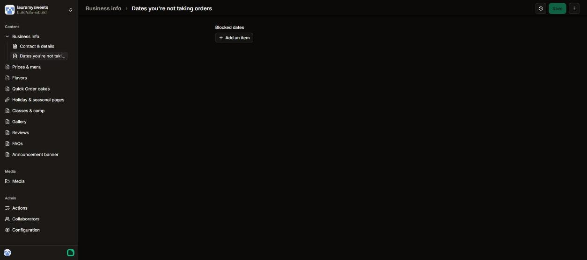

# Editing your website: a guide for Laura

You can change your prices, menu, holiday pages, classes and photos yourself, from your phone or computer. You don't need to touch any code, and you can't break the design.

**How it works:** you change something in your dashboard and click **Save**. About a minute later, the change is live on lauramysweets.com. Every save is kept, so nothing is ever lost. If something looks wrong, text Noah and he can put it back.

---

## 1. Logging in

1. Go to **app.pagescms.org**.
2. Type **lauramysweets@gmail.com** in the Email box and click **Continue with email**.
3. Open the email Pages CMS sends you and click the sign-in link.
4. Click **lauramysweets**.

You'll see your dashboard. The menu on the left lists everything you can edit.

| Section | What's in it |
|---|---|
| Business info | Phone, email, hours, delivery details, towns you serve, Google review count, and dates you're not taking orders |
| Prices & menu | Cake, cupcake, cake pop and treat prices |
| Flavors | Cake flavors, fillings, buttercreams, shooter flavors |
| Quick Order cakes | The 6 set designs, their prices and photos, notice days |
| Holiday & seasonal pages | Thanksgiving, Christmas and any holiday you add |
| Classes & camp | Turn classes on or off, add sessions |
| Gallery | Your photos |
| Reviews | Google reviews, copied exactly |
| FAQs | Questions and answers |
| Announcement banner | The dark strip across the top of every page |

> **Yellow highlights on the website** mean something still needs real information from you. Find the matching field in your dashboard and replace the text that starts with `[[PLACEHOLDER`.

---

## 2. Changing a price

1. Click **Prices & menu**.
2. Find the item, for example **6 inch cake: $55**, and click the little arrow to open it.
3. Change the **Starting price**. Type numbers only, no $ sign (for example `60`).
4. Click **Save** at the top right.

That's it. The new price shows everywhere it appears: the menu, the birthday cake page, the homepage, and the information Google reads.

**Quick Order prices** live in **Quick Order cakes**. Open a design and change **Price for the 6 inch size** or **Price for the 8 inch size**. The "Quick Order cakes from $60" on the homepage updates by itself to the lowest price.

---

## 3. Turning a holiday page on or off

Holiday pages never get deleted. When a holiday is over, you switch it to off-season, and the page stays up with a waitlist so people can sign up for next year. (That also keeps it showing up on Google.)

1. Click **Holiday & seasonal pages**, then **Edit** next to the holiday.

   

2. Change **Status**:
   - **On: taking pre-orders** puts the page in the website menu and on the homepage.
   - **Off-season: show waitlist** takes it out of the menu and shows "These treats are back next season" with a sign-up form.
3. Fill in the intro, pre-order deadline, pickup dates and treats (name, description, price, photo).
4. Click **Save**.

**Adding a new holiday** (like Valentine's Day): click **Add an entry**. For **Web address**, use lowercase words with dashes, like `valentines-day`. Pick an accent color. Once the page is live, don't change its web address.

**Tip:** to tell everyone, also turn on the **Announcement banner** with a short message like "Valentine's Day pre-orders are open" and a link to the page (for example `/holiday/valentines-day/`).

---

## 4. Adding a class session

1. Click **Classes & camp**.
2. Under **Sessions**, click **Add an item**.
3. Fill in the session name, date (and end date for a camp), time, spots left, and sign-up status (**Open**, **Waitlist** or **Full**).
4. Turn on **Classes are open for sign-up** if it's off.
5. Click **Save**.

When classes are off, the classes page stays up with a "Get notified about the next classes" form. When a session fills, change its status to **Full** and it disappears from the sign-up dropdown.

---

## 5. Uploading a gallery photo

1. Click **Gallery**.
2. Scroll to the bottom and click **Add an item**.
3. Under **Photo**, click to upload a picture from your phone or computer (JPG, PNG or WebP).
4. In **Describe what the photo shows**, write one plain sentence, for example *"Two-tier pink buttercream cake with gold sprinkles and a number 1 topper."* This helps people using screen readers, and it helps Google show your cakes in image search.
5. Pick a **Category**: Birthday, First Birthday & Smash, Wedding & Events, Cupcakes & Cake Pops, or Holiday. The photo then shows on the matching page too.
6. Turn on **Show on the homepage** for your favorites (pick about 3 to 6).
7. Click **Save**.

**Photo tips:** use your original photos at full size, not screenshots. The website shrinks them for phones by itself. Crop if you like, but please don't use filters that change how the cake looks.

---

## 6. A few more things you might want

- **Blocking off dates** (vacations, booked-up weekends): **Business info → Dates you're not taking orders → Add an item.** Customers won't be able to pick those dates on the order forms.

  

- **New Google reviews:** **Reviews → Add an item.** Copy the review exactly as written on Google, with the person's first name. Also update the review count under **Business info → Google reviews**.
- **Hiding a Quick Order design** for a while: open it in **Quick Order cakes** and turn off **Available to order**.
- **New flavor:** add it in **Flavors**. It shows up on the menu and in the order form dropdowns automatically.

## Please don't

- Delete things you might want back. Turn them off instead (holiday status, design "Available", banner "Show").
- Add your street address anywhere. The site only shows Coopersburg, PA 18036.
- Write reviews or change their wording.

Questions? Text Noah.
